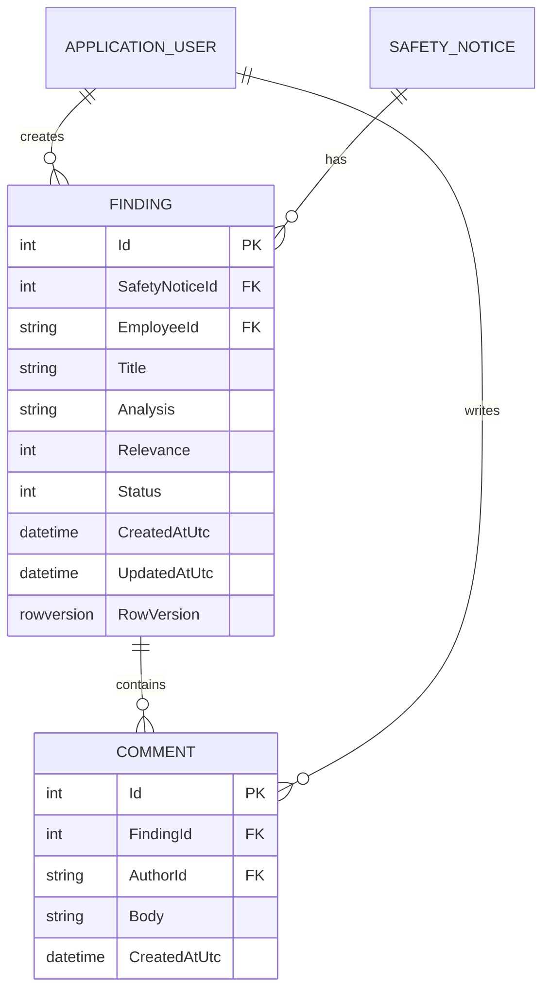
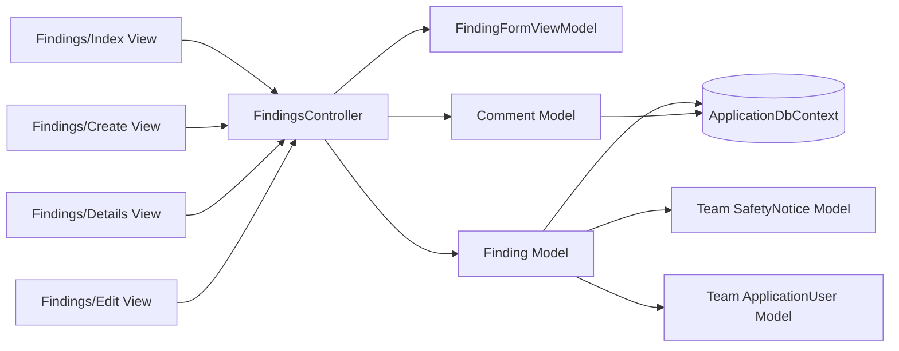

# Patrick — Software Design Contribution

## Findings wireframe

```text
+---------------------------------------------------------------+
| Finding Details                                  [Edit Finding]|
| FDA reference · Device name                                   |
+---------------------------------------------------------------+
| Relevance: High              Status: Under Review             |
|                                                               |
| Risk-review analysis                                          |
| [ Employee's analysis text................................. ] |
| [ ........................................................ ] |
+---------------------------------------------------------------+
| Employee Comments                                             |
| Employee | date/time                                          |
| Existing comment                                              |
|                                                               |
| [ Add a comment............................................ ] |
|                                           [Add Comment]        |
+---------------------------------------------------------------+
```

## ERD contribution



## MVC contribution



## Design decisions
- A ViewModel is used for Create/Edit to avoid binding the database entity directly.
- Findings are filtered by authenticated employee ID for ownership protection.
- Data Annotations provide server-side validation and work with MVC client validation.
- `AsNoTracking()` is used for read-only queries.
- A row-version token supports optimistic concurrency on edits.
- Database exceptions are handled without exposing internal exception details to the user.
