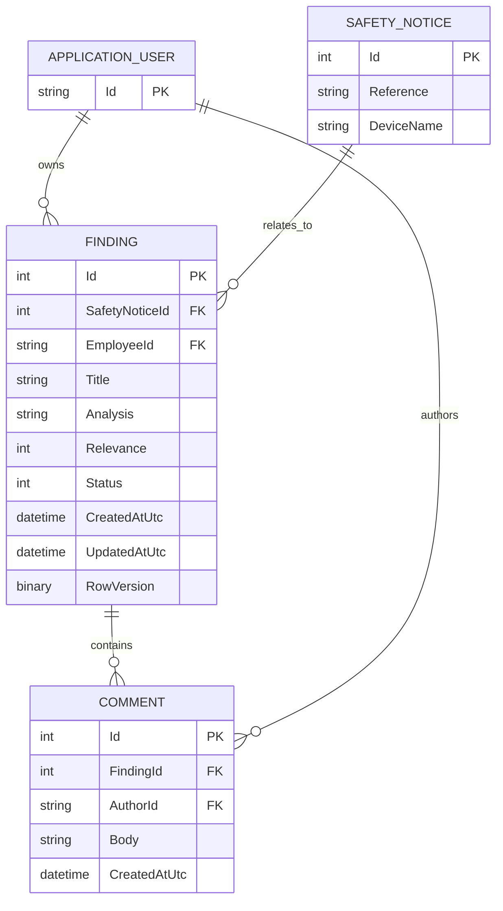

# Risk Findings and Employee Comments — ERD

This is Patrick's component-level ERD. The shared team ERD must be checked before database migration.

## Cardinality and integrity
- One safety notice may have zero or many findings; each finding belongs to exactly one notice.
- One application user may own zero or many findings; each finding has exactly one owner.
- One finding may have zero or many comments; each comment belongs to exactly one finding.
- One application user may author zero or many comments; each comment has exactly one author.
- Deleting a finding cascades to its comments. Deleting a notice/user is restricted by the component's proposed EF mapping.

## Integration assumptions
The `APPLICATION_USER` and `SAFETY_NOTICE` tables are owned by the team. Their exact table names, column types, and navigations are **not verified**. In particular, the `RowVersion` concurrency strategy depends on the selected database provider. Do not apply migrations before confirming the shared model.
